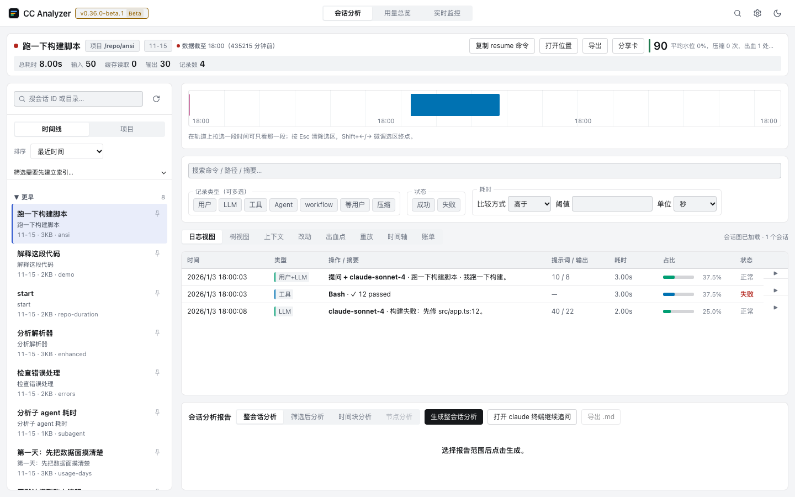
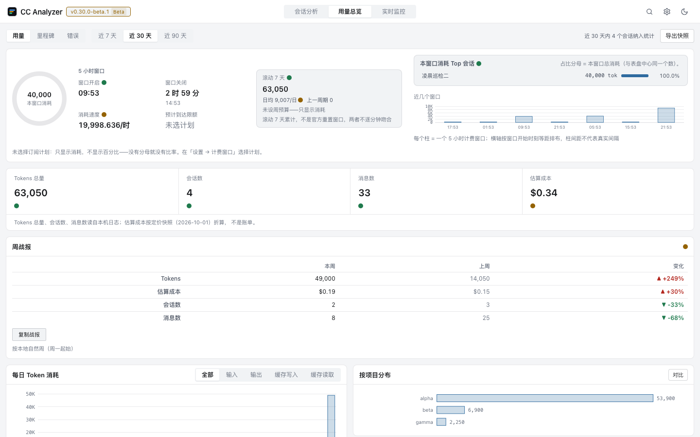
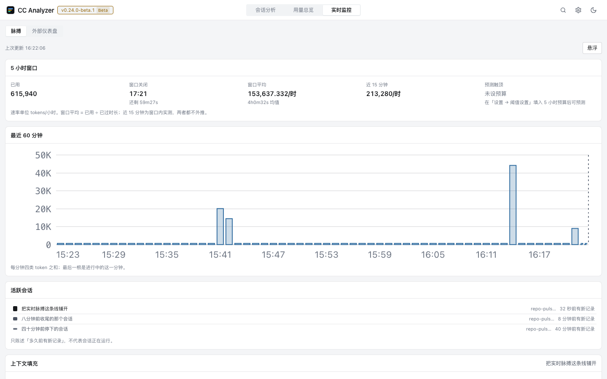

# CC Analyzer

[English](README.md) · [简体中文](README.zh-CN.md)

[](https://github.com/liang-zhenxiang/cc-analyzer/actions/workflows/ci.yml)
[](https://github.com/liang-zhenxiang/cc-analyzer/releases)
[](https://scorecard.dev/viewer/?uri=github.com/liang-zhenxiang/cc-analyzer)
[](LICENSE)

A desktop application for reviewing AI coding session activity — turn your
Claude Code session logs into timelines, duration trees, and structured
analysis reports. Built with Tauri 2 and a React web UI.

Claude subscription plans meter usage in rolling five-hour windows, so the
numbers people check all day are always the same three: when the current
window closes, how much of it is left, and — at the rate you are burning
through it — when you will hit the limit. The usage overview answers all
three from your own logs, with no account and no network call.



The session analyzer with a session open — grouped session list on the left,
filters and the log table in the middle, the analysis report panel below.



The usage overview — the 5-hour billing-window card (current consumption, open
and close times, a burn-rate projection), KPI readouts, and token trends and
distributions for the last 7 / 30 / 90 days, every figure carrying a provenance
badge.



The live pulse — what is being written right now. Active sessions, the token
rate for the last 60 minutes (the in-progress minute drawn as texture, never
extrapolated), the current 5-hour window, and how full the context of the most
recent session is.


The context bleed view — what ate this session's context. One line states the
fact, then every attributable category is listed with its own evidence grade:
`logged` readings are checkable against the log, while `countOnly` rows (tool
calls, whose token volume does not exist in the log at all) report a count and
say why. Every screen, in both light and dark themes, is archived in
[`docs/screenshots/`](docs/screenshots).

## Features

- **Context forensics (new)** — every Claude Code session carries a context
  that fills up and is occasionally compacted: old messages are rewritten into
  a summary and silently leave the model's working memory. CC Analyzer is the
  first tool that makes this visible and *attributable*. The session's
  **Context** tab draws an "context ECG": the per-call context size (input +
  cache-write + cache-read) as an area chart where each compaction is a cliff.
  Click a cliff to open the forensic card — before/after sizes, tokens
  dropped, duration, trigger (auto/manual), and the surviving-message list
  from the log's own `preservedMessages` — and a **"dropped from context"
  list** that names, message by message, what left the context at that
  boundary (with a *user-only* filter for "when was my constraint dropped").
  Rows jump straight back to the log view. Compaction also appears as a
  full-width band row in the log table, as a **compaction panel** in the
  usage overview (count, cumulative dropped tokens, auto/manual split, top-3
  sessions — the "where did my limit go" narrative), and the log view now
  shows a **parse-coverage chip** when the parser meets record types it does
  not recognize (the report goes to your clipboard only — format drift
  becomes visible instead of silently dropped). No invented numbers: fields
  the log doesn't carry read "not recorded", and no "official context limit"
  line is drawn because no such source exists.
- **Context bleed — what ate this session's context, and how much of each
  reading is fact** — the **Bleed** tab ranks the attributable consumption of
  a session by category: **compaction loss** (one row per compaction
  boundary, with the messages that left the context counted individually),
  **tool output** (ranked by call count, top 6 plus a folded tail row), and
  **cache rewrites** (calls whose `cacheCreation` sits well above that
  session's median). One line at the top states the fact: `N compactions
  dropped M messages` — and when there were none it says "this session was
  never compacted" rather than a friendlier-sounding number. The core design
  is **evidence grading**: every row carries `logged` (the token volume is
  read straight from the record's `usage` and can be checked item by item) or
  `countOnly`, because the parser's `kind === "tool"` records carry no
  `usage` at all — how many tokens a tool call occupies simply does not exist
  in the log. Tool rows therefore report a count only, show `0` in the token
  columns, and say outright why — never letting a `0` pass as "takes no
  space". Money and tokens are separate fields because their evidence differs:
  money is converted through the existing pricing snapshot, `null` means
  nothing could be priced (not `$0`), and `0` is a legitimate "it really is
  $0", with the count of excluded calls written beside it. There is
  deliberately **no fake global ordering** — the three categories sort by
  different keys (time / count / none), so the source comments rule that no
  meaningful single order exists; the list keeps the model's order and the
  footer names each category's sort key. The three empty states are three
  different facts, each with its own copy. Every row in the session list now
  carries a **bleed badge** (`N compactions`), and clicking it jumps straight
  to that session's Bleed tab. The badge is a real button, so the row itself
  moved from `<button>` to a `role="button"` div (a button cannot nest a
  button), with the keyboard behaviour restored by hand and locked down in
  unit tests.
- **Two-tier usage limits** — Claude subscriptions meter usage in two layers;
  the app reads both. The **5-hour billing window**: the current consumption
  dial, when the window opened, a countdown to when it closes, and a projection
  of when you will reach the limit at the current burn rate (clustering matches
  ccusage's `blocks`: five hours from the first activity). The **rolling 7-day
  window**: consumption over `(now − 7d, now]` is an exact figure read from
  your logs, shown with the daily average and the previous period for
  comparison. The weekly budget is an optional number you set yourself — no
  reliable community estimate exists, so plan presets ship without one — and
  the interface says outright that a rolling 7 days is not the official reset
  window. Plan limits are community estimates and are labelled as such; with no
  plan or budget selected the app shows consumption only, never a percentage it
  cannot stand behind — and a window younger than 30 minutes says "not enough
  data" instead of extrapolating. Derived entirely from the local log.
- **Menu-bar readout** — both layers can stay visible in the **macOS menu bar / Windows
  tray**: the label beside the icon carries a single number (a percentage when a budget
  exists, the consumed tokens when it does not), and hovering shows the full two-layer
  reading, when the window closes, and **how many minutes ago the reading was computed** —
  a reading that leans on an estimate says so on its own line instead of passing as fact.
  Read entirely from local logs, never uploaded; hide it in settings and every statistic
  stays exactly as it was.
- **Encrypted archive bundles (moving machines)** — the local archive lives on one machine.
  Settings → Local archive can export it as a **single encrypted file** (`.ccabundle` =
  tar + age passphrase encryption) and import it on another machine. Importing the same
  bundle twice is **idempotent** (the second run reports everything as already present);
  a session that moved on in two places keeps both versions rather than overwriting either.
  The passphrase exists only while you type it — **never stored, never uploaded, no
  recovery**, so a forgotten passphrase means an unopenable bundle; the file is standard
  age, so the `age -d` CLI can decrypt it too. Import writes only into the app's own
  archive directory and never touches `~/.claude`. (Minimum Rust is now 1.85.)
- **Quota attribution ("who is burning this 5-hour window")** — the two limit layers only
  ever said *how much*; the next question is *which session*. The 5-hour card now carries
  a **Top sessions** block: title, tokens consumed inside the window, a share bar and a
  percentage, and clicking a row opens that session. Past five sessions a trailing
  "N other sessions" row keeps the shares from looking like they lost money. There is
  exactly one set of numbers: the window boundaries and the denominator come from the same
  block the gauge is drawn from (share = of this window's total), and a session that spans
  a window boundary is **split by record timestamps** rather than counted whole — so the
  percentages can never disagree with the gauge. Read from local logs only; no inference,
  no network. v1 covers the 5-hour layer; the weekly window and per-model/tool breakdowns
  come later.
- **Usage snapshot (shareable single file)** — the Usage tab's header carries **Export
  snapshot**: the current range's KPIs, daily trend, per-project and per-model
  distributions, activity heatmap, both limit layers and the window's top sessions are
  drawn into **one self-contained HTML file** — no scripts, no external resources, every
  value escaped, project directory names only. The provenance travels with the numbers
  (read from the log / estimated / pricing snapshot date) and the generation time is
  stated separately from the data window, so "generated at" is not read as "data ends at".
  The document also says plainly what it does **not** contain (tool & skill census,
  compaction stats, error view) so a colleague does not take it for the whole dashboard.
  Nothing is uploaded and there is no share link — you carry the file yourself.
- **Global search (⌘K / Ctrl+K)** — search across every project and session covers
  **four kinds of content**: your prompts and the assistant's replies, **tool output,
  file paths and error text**. Every hit carries a source label (me / assistant / tool
  output / file path / error) and you can filter by source — the most useful being
  "file paths only" when you are hunting for a file — or type a `路径:` style prefix to
  switch filters as you type. Terminal escape sequences are stripped before indexing, so
  searching `[31m` no longer matches control bytes, and a single tool output is capped at
  2000 indexed characters. Matching stays plain case-insensitive substring: the problem
  being solved is "I cannot find it at all". Results are grouped by project → session
  with the matching snippet and a relative time; Enter jumps into the session, opens the
  record and expands its detail panel. The index is built in the background and lives in
  memory only — never written to disk, never uploaded (path hits are shown as-is inside
  the app precisely because search is not exported and not logged).
- **Usage overview** — token consumption trends for the last 7 / 30 / 90 days,
  per-project and per-model distributions, and a 7×24 activity heatmap, all
  visible without scrolling on a 1440×900 screen. Every figure carries a
  provenance badge (read from the log / estimated), the estimated cost is
  priced per model against an offline pricing snapshot (date shown), and
  everything is aggregated locally — nothing is uploaded.
- **Usage calendar** — a GitHub-contribution-graph grid over a rolling
  12 months: cell shade = the day's estimated cost quartile (level 0 = no
  spend), hovering shows cost / tokens / sessions / project, and clicking a
  day expands **a day in review**: a summary line (spend as cost *and* tokens,
  sessions, messages, the active span from first to last record, top model,
  projects touched) above a **24-hour timeline**, one row per session — project
  colour dot, a solid track with activity blocks whose height encodes how busy
  that clock hour was, start–end plus duration, and the day's cost / tokens /
  share. Rows run in start order and clicking one opens that session; a session
  that crossed midnight is drawn as the part that falls inside the day and says
  so. Below the legend sits a **year in insights**: six factual sentences —
  longest / current streak, priciest day, longest gap, active share, and this
  month vs. the same days last month — all on the same scale as the cells
  (days with unknown pricing never count as spend), with dates that drill into
  the day-in-review. The window is a fixed rolling 365 days and does not follow
  the range selector; on narrow windows the grid scrolls inside its own
  container.
- **Milestones** — the usage overview's third sub-view folds your **entire
  history** into three groups of facts you can check against the logs:
  **firsts** (first session, compaction, subagent, skill, MCP tool),
  **cumulative tiers** (tokens, sessions, messages, projects, models,
  compactions, tool kinds — the thresholds are hard-coded constants), and
  **single-session records** (most tokens, longest session, most compactions).
  A reached milestone shows its evidence: a number, a date, and a link into the
  session that earned it. An unreached one shows the honest distance to the next
  tier — never a grey silhouette, a lock or a "??". Every badge has to be
  recomputable from the logs, so cumulative cost (the one figure that reads an
  expiring pricing snapshot) deliberately stays out; the KPI and the calendar
  shading carry it. It shares the same full-history pass as the other two
  sub-views: no extra scan, no extra request.
- **Session explorer** — sessions grouped by timeline (today / yesterday /
  this week / this month / earlier) and by project, with incrementally
  scanned titles and relative times.
- **Local archive** — copy sessions into the app's own data directory before
  Claude Code prunes them (~30 days), then keep browsing and analysing them
  across months and years. Incremental by mtime/size, raw timestamps preserved,
  originals untouched, nothing uploaded. Archived sessions carry a badge and a
  session whose original is already gone still shows up.
- **Interface font scaling** — five steps (90 / 100 / 110 / 120 / 130%) in
  settings, applied instantly and remembered on this machine. Font sizes and
  line heights scale **together**, so tables, readout rows and chart labels
  grow while spacing, icons and the gauge keep their size — legibility, not a
  zoomed page. The chosen step survives a restart; pick 100% to go back.
- **High-contrast mode** — settings → interface contrast offers *normal* and
  *high contrast*. High contrast swaps **both palettes** (semantic colours and the
  category/chart colours), and the values are computed, not eyeballed: body text
  reaches at least 17.4:1, secondary text 7.29:1 and borders 3.83:1 against their
  backgrounds (WCAG 2.1 relative luminance; thresholds 7 / 4.5 / 3). Focus rings
  grow to 3px with a 2px offset — on a dark button the offset is what keeps the
  ring readable from both sides. Only colours and focus rings move: font sizes,
  spacing and control sizes stay put, because high contrast is not a zoom. With no
  explicit choice the app follows the system's `prefers-contrast: more`; once you
  pick a step, your choice wins and is remembered on this machine. Exported
  documents (session report / usage snapshot) keep their own palettes in this
  round, and Windows `forced-colors` is not handled yet.
- **Log view with one row model** — user / LLM / tool / agent / workflow /
  wait rows plus a full-width **compact-boundary band row** (the compaction
  summary is folded into its expandable section, never counted as user
  speech), with duration and share columns; filter by row kind,
  success/failure, duration range, or free text. Tool output keeps the terminal
  colours it was written with (ANSI SGR, 256-colour and true-colour, carriage
  returns resolved) while every table cell, copy action and export stays plain
  text.
- **Duration tree** — agent and workflow sub-sessions resolved into a graph
  with graph-backed durations; drill into any node or analyse a selected
  time block only.
- **AI analysis reports** — structured prompts sent to your local `claude`
  CLI, rendered as Markdown with syntax highlighting; cancellable at any
  time, with per-node and per-time-block scoping.
- **Export & share** — turn a session into a **single-file HTML report**
  (self-contained: no scripts, no CDN, no fonts to fetch; everything escaped)
  or a **CSV** for Excel and scripts, over the current filter or the whole
  session. Save it through the native dialog or copy it to the clipboard; the
  report carries the project's directory name, never a full path.
- **Session readouts, ruler and keyboard navigation** — the session header
  opens with a readout row (total duration / input / cache read / output /
  records), clicked to expand the token panel; the timeline gained tick marks,
  a hover crosshair and a live selection readout; the three data tables share
  one row-navigation model (↑↓, Home/End, Enter/Space). A button in the header
  copies a ready-to-run `claude --resume` command for that session.
- **Two-channel auto-update** — choose the stable channel (default, promoted
  after maintainer verification) or the beta channel (built automatically each
  feature round), check on demand and install with one click. Packages are
  signature-verified, and a check is a single read of the GitHub releases
  page — no data is uploaded.
- **Realtime monitor** — opens on a native **live pulse** that reads your
  local logs: active sessions, the last 60 minutes of token rate, the current
  5-hour window, and context fill. The external monitoring dashboard you run
  yourself (not shipped in this repo) is a sub-view you open on demand. The
  whole view fits a 420px always-on-top floating widget.
- **Performance at scale** — windowed, measured-height rendering and chunked
  parsing keep large sessions (tens of MB of JSONL) responsive.
- **Local-first & private** — everything is parsed and rendered locally; the
  app ships no telemetry. Errors say what failed and what to do next; the raw
  error string, which can carry your local paths, stays out of the interface
  unless you expand the details.

## Quick start

### Download

Grab the build for your platform from
[Releases](https://github.com/liang-zhenxiang/cc-analyzer/releases):

| Platform | Download |
| --- | --- |
| macOS Apple Silicon | `CC-Analyzer_<version>_aarch64.dmg` |
| macOS Intel | `CC-Analyzer_<version>_x64.dmg` |
| Windows x64 | `CC-Analyzer_<version>_x64-setup.exe` — installer (Start menu entry, uninstaller) |
| Windows x64 (portable) | `CC_Analyzer_x64_portable.zip` — unzip and run, no installation |

Open the dmg and drag **CC Analyzer** onto the `Applications` shortcut.
macOS bundles are ad-hoc signed: on first launch, right-click the app and
choose **Open** to pass Gatekeeper.

### Build from source

Requirements: Node.js 22 & npm, Rust 1.85+, Xcode Command Line Tools
(macOS) or Visual Studio Build Tools (Windows).

All three platforms go through Tauri's official bundler, so the bundle
identity (`identifier`, `copyright`, installer shape) comes from a single
source: `src-tauri/tauri.conf.json`.

```bash
npm install                    # build toolchain (Tauri CLI)

# macOS Apple Silicon            → dist-arm64/CC Analyzer.app + .dmg
npm run build:macos:arm64

# macOS Intel (cross-compiled)   → dist-intel/CC Analyzer.app + .dmg
npm run build:macos:intel

# Windows (PowerShell)           → dist-windows/ NSIS installer + portable zip
npm run build:windows
```

The packaging scripts under `scripts/` wrap the same commands, so
`./scripts/build-macos.sh x86_64` works too. macOS artifacts use ad-hoc
signing (`signingIdentity: "-"`), which needs no developer certificate.

## Documentation

| Document | Contents |
| --- | --- |
| [docs/USAGE.md](docs/USAGE.md) | Full user guide: install, every feature, data & privacy |
| [docs/ARCHITECTURE.md](docs/ARCHITECTURE.md) | How it works, design decisions and rejected alternatives |
| [docs/TROUBLESHOOTING.md](docs/TROUBLESHOOTING.md) | Symptoms → causes → fixes, searchable error texts |
| [docs/LOCAL_DEVELOPMENT.md](docs/LOCAL_DEVELOPMENT.md) | Local desktop development workflow |
| [docs/CI.md](docs/CI.md) | CI build order and the `frontendDist` pitfall |
| [docs/MAINTAINER_GUIDE.md](docs/MAINTAINER_GUIDE.md) | Release process, repository configuration checklist |
| [CHANGELOG.md](CHANGELOG.md) | Notable changes per version |
| [CONTRIBUTING.md](CONTRIBUTING.md) | How to contribute ([中文](CONTRIBUTING.zh-CN.md)) |
| [SECURITY.md](SECURITY.md) | How to report vulnerabilities, the project's threat model |

## Development

```bash
cd web && npm install && npm run dev   # Vite dev server on 127.0.0.1:5173
cargo run --manifest-path src-tauri/Cargo.toml
```

Pre-push checks — run the layers your change touches. The authoritative rules
(which layer a change needs, and what counts as done) live in
[`.trellis/spec/testing/`](.trellis/spec/testing/index.md), reached from
[`AGENTS.md`](AGENTS.md) → Testing Guidelines; the command list below is a
summary kept in sync with that source.

```bash
./scripts/lint.sh                       # static checks: actionlint, yamllint, shellcheck, zizmor
npm --prefix web test                   # unit / component tests (Vitest)
npm --prefix web run test:e2e           # end-to-end tests (Playwright, Chromium + WebKit)
npm --prefix web run build              # type-check + production build
cargo fmt --manifest-path src-tauri/Cargo.toml --check
cargo clippy --manifest-path src-tauri/Cargo.toml --all-targets -- -D warnings
cargo check --manifest-path src-tauri/Cargo.toml
cargo test --manifest-path src-tauri/Cargo.toml
./scripts/gui-test.sh                   # packaged-app smoke test (a build must exist; run after packaging / IPC changes)
```

## Repository layout

```
web/           React, TypeScript and Vite source for the UI
src-tauri/     Tauri 2 backend: Rust command layer, app config and bundle config, icons
scripts/       packaging entry points, lint entry point, commit-msg validator
docs/          usage, architecture, troubleshooting, maintainer guides
.github/       workflows, issue/PR templates, governance configs
package.json   build toolchain (Tauri CLI) and the packaging entry points
```

## Roadmap

The roadmap tracks open issues; each item links to the issue that owns it.

- [x] Local archive repo — keep sessions past Claude Code's own cleanup, and
  analyse across months and years (shipped in v0.12.0; encrypted bundles that
  move history between machines in v0.16.0)
  ([#70](https://github.com/liang-zhenxiang/cc-analyzer/issues/70))
- [x] Structured export — CSV and single-file HTML (shipped in v0.11.0)
  ([#71](https://github.com/liang-zhenxiang/cc-analyzer/issues/71))
- [x] Live pulse — the "Live monitor" tab is a native view: active sessions,
  token rate, 5-hour burn rate and context-fill curve, with a 420×620
  always-on-top window (shipped in v0.26.0-beta.1)
  ([#203](https://github.com/liang-zhenxiang/cc-analyzer/issues/203))
- [x] Accessibility & performance pack — ANSI rendering, virtual scrolling,
  font scaling
  ([#73](https://github.com/liang-zhenxiang/cc-analyzer/issues/73))
- [ ] Milestones — every badge has to be recomputable from the logs: firsts,
  cumulative tiers and single-session records, each shown with its evidence
  and a link to the session or day that earned it
  ([#214](https://github.com/liang-zhenxiang/cc-analyzer/issues/214))
- [ ] Frontend upgrade to React 19, moving `@types/react` / `@types/react-dom`
  together
  ([#19](https://github.com/liang-zhenxiang/cc-analyzer/issues/19))

Have an idea? [Open a feature request](https://github.com/liang-zhenxiang/cc-analyzer/issues/new/choose).

## Contributing

Contributions are welcome — bug reports, documentation improvements and pull
requests alike. Start with [CONTRIBUTING.md](CONTRIBUTING.md), run the local
checks, and keep one change per PR.

## Security

Session data is sensitive. The app parses it locally and ships no telemetry;
see [SECURITY.md](SECURITY.md) for the threat model and how to report
vulnerabilities privately.

## License

[MIT](LICENSE). Third-party notices: [NOTICE](NOTICE).
