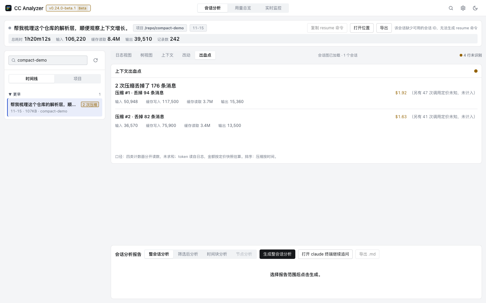

# CC Analyzer

[English](README.md) · [简体中文](README.zh-CN.md)

[](https://github.com/liang-zhenxiang/cc-analyzer/actions/workflows/ci.yml)
[](https://github.com/liang-zhenxiang/cc-analyzer/releases)
[](https://scorecard.dev/viewer/?uri=github.com/liang-zhenxiang/cc-analyzer)
[](LICENSE)

把 AI 编码会话记录变成时间线、耗时树和结构化分析报告的桌面应用。
基于 Tauri 2 与 React Web UI 构建。

> 完整文档以[英文版 README](README.md) 为准；两份 README 结构一致，
> 细节文档（使用手册、架构、排错）目前以英文与中文并行维护。

订阅套餐按**滚动 5 小时窗口**计量用量，所以你一天要看几十次的就是那三个问题：
当前窗口什么时候关、还剩多少、按现在的消耗速度什么时候触顶。「用量总览」用你
自己的会话日志把这三个问题都答了——不需要账号，也不联网。


打开会话后的「会话分析」页——左侧是分组会话列表，中间是筛选区与日志表，
下方是分析报告面板。


「用量总览」页——顶部是 5 小时计费窗口卡片（本窗口消耗、开启与关闭时刻、
按消耗速度外推的到达限额时刻），接着是 KPI 读数行，以及近 7 / 30 / 90 天的
token 消耗趋势与分布，每个数字带来源徽章。


「实时脉搏」页——此刻在写什么。活跃会话、最近 60 分钟的每分钟速率（进行中的
这一分钟用纹理画出，不外推成整分钟）、当前 5 小时窗口，以及最近那个会话的
上下文填充程度。



「上下文出血点」页——这个会话的上下文是被什么吃掉的。顶部一行如实说事实，
下面每个可归因的类别各带**证据等级**：`logged` 的读数可以对着日志逐条核对，
而 `countOnly` 的行（工具调用——它的 token 量在日志里根本不存在）只报次数并
写明原因。每个界面的浅色与深色截图都归档在
[`docs/screenshots/`](docs/screenshots)。

## 功能特性

- **上下文取证（新）** —— 每个 Claude Code 会话都带着一份会不断填满、并偶尔被压缩的
  上下文：旧消息被改写成摘要、悄无声息地离开模型的工作记忆。CC Analyzer 是第一个把它
  变得**可见且可归因**的工具。会话的**上下文**档画出「上下文心电图」：每次调用的上下文
  体量（input + 缓存写入 + 缓存读取）面积图，每次压缩是一道断崖。点断崖打开法证卡——
  前后体量、丢弃 token、耗时、触发方式（自动 / 手动），以及从日志自带的
  `preservedMessages` 读出的幸存消息清单——外加一份**「被丢出上下文」清单**，一条条
  点名在那个边界上离开上下文的东西（带**只看用户消息**过滤档，回答「我的约束是什么时候
  被丢的」）。行可以直接跳回日志档。压缩同时出现在三处：日志表的整带宽行、用量总览的
  **压缩面板**（次数、累计丢弃 token、自动 / 手动拆分、Top-3 会话——「我的额度去哪了」
  的叙事），以及解析器遇到不认识的记录类型时的**解析覆盖率提示条**（报告只进你的剪贴板
  ——格式漂移变得可见，而不是被静默丢弃）。不编造数字：日志不带的字段读作「未记录」，
  也不画「官方上下文上限」那条线，因为不存在这样的来源。
- **上下文出血点 —— 这个会话的上下文是被什么吃掉的，以及每条读数有多少是事实** ——
  **出血点**档按类别列出可归因的上下文消耗：**压缩丢弃**（每个压缩边界一行，被丢出
  上下文的消息逐条可数）、**工具输出**（按调用次数排名，前 6 名加折尾一行）、
  **缓存重写**（`cacheCreation` 显著高于该会话中位数的时刻）。顶部一句话如实说事实：
  `N 次压缩丢掉了 M 条消息`——没有压缩就说「本会话没有发生压缩」，不给一个听起来更
  吉利的数字。核心设计是**证据分级**：每条条目带 `logged`（token 体积直接读自记录的
  `usage`，可逐条核对）或 `countOnly`，因为解析器产出的 `kind === "tool"` 记录
  **不带 `usage`**——工具调用占多少 token 在日志里根本不存在。所以工具类只报次数、
  token 栏显示 `0`，并直言原因，**绝不让一个 `0` 冒充「不占空间」**。金额与 token 是
  两个字段，因为证据等级不同：金额按既有定价快照折算，`null` 表示没有一条能定价
  （不是 `$0`），`0` 是合法的「真的就是 $0」，旁边写明未计入的调用数。**刻意不给一个
  假的全局排序**——三类按不同键排序（时间 / 次数 / 无），源码注释认定不存在有意义的
  单一序；清单保持模型原序，页脚写明每类的排序键。三种空态是三件不同的事实，各有各的
  文案。会话列表每行新增**出血点徽章**（`N 次压缩`），点击直接跳到该会话的出血点档。
  徽章是真按钮，因此行本体从 `<button>` 迁到 `role="button"` 的 `div`（按钮不能嵌
  按钮），键盘行为手工补齐并锁进单测。
- **两层用量限额** —— Claude 订阅按两层计量用量，应用两层都读。**5 小时计费
  窗口**：当前消耗表盘、窗口开启时刻、关闭倒计时，以及按消耗速度外推的「预计
  到达限额时刻」（窗口聚类与 ccusage 的 `blocks` 同口径：首条活动起算 5 小时）。
  **滚动 7 天窗口**：`(now − 7d, now]` 区间的消耗是从日志读出的精确值，旁边给
  日均线与上一周期对照。周预算是可选的自设数字——没有可靠的社区估算值，计划
  预设一律不填；界面也明说「滚动 7 天累计，不是官方重置窗口」。限额是社区整理
  的估算值并如实标注；未选计划或未设预算时只显示消耗、不显示百分比——没有分母
  就没有比率；运行不足 30 分钟的窗口明示「样本不足」，不外推一个看起来很自信的
  时刻。全部由本机日志推导。
- **菜单栏常驻读数** —— 两层用量可以常驻 **macOS 菜单栏 / Windows 托盘**：图标旁的文字只放
  一个读数（设了预算就是百分比，没设就是已用 token），悬停给出完整的两层读数、窗口还有多久
  关闭，以及**这份读数是几分钟前算的**——读数含估算来源时会单列一行说明，不含就不写，绝不
  把估算说成事实。数据全部读自本机日志、不联网；不想看就在设置里关掉，用量总览与统计照常。
- **加密归档包（跨机器）** —— 本地归档只留在这台机器上。设置 → 本地归档可以导出一个
  **单文件加密包**（`.ccabundle` = tar + age 口令加密），拷到另一台机器导入即可把历史带过去。
  同一份包重复导入是**幂等**的（第二次全部报「已存在」）；同一会话在两台机器各自更新过则两份
  都留、不覆盖。口令只在你输入的那一次存在——**不落盘、不上传、没有找回**，忘了就是打不开；
  包是标准 age 格式，命令行 `age -d` 同样能解开它。导入只写应用自己的归档目录，不碰
  `~/.claude`。（最低 Rust 版本随之提到 1.85。）
- **按会话的配额归因（谁在烧这个 5 小时窗口）** —— 两层限额一直只说「总共用了多少」，
  下一句要问的是「哪个会话」。5 小时窗口卡里多了一块**本窗口消耗 Top 会话**：会话标题 +
  窗口内消耗 + 占比条 + 占比百分比，点一行就打开那个会话；超过 5 个收尾一行「其余 N 个会话」，
  占比表不会看起来漏账。数字只有一套——窗口边界与占比分母取自表盘那同一个读数
  （占比分母 = 本窗口总消耗），**跨窗口的会话按记录时间被切开**而不是整条计入，所以面板百分比
  与表盘不可能对不上。只读本机日志，不推算、不联网；v1 只做 5 小时层，周窗口与按模型 / 工具
  再切一层留给后续。
- **用量快照（可分享的单文件）** —— 用量页头部多了「**导出快照**」：当前区间的 KPI、
  每日趋势、按项目 / 按模型分布、活跃时段热力图、两层限额与本窗口消耗 Top 会话，全部画进
  **一个自包含的 HTML 文件**——零脚本、零外链资源、所有文本转义、只出现项目目录名。
  口径跟着数据一起走（读自日志 / 估算 / 定价快照日期），生成时刻与数据窗口分开写，免得
  「生成于」被读成「数据截止于」；文档里还明说**不含**什么（工具与 skill 普查、压缩统计、
  错误档），同事不会把它当成整页仪表盘。不上传、不生成分享链接——文件你自己搬。
- **全局搜索（⌘K / Ctrl+K）** —— 跨全部项目、全部会话的检索覆盖**四类内容**：
  你的指令与助手回复、**工具输出、文件路径、错误文本**。每条命中都带来源标签
  （我 / 助手 / 工具输出 / 文件路径 / 错误），并可按来源过滤——找文件时最有用的是
  「只看文件路径」那一档，也可以直接敲 `路径:` 这样的前缀边打边切档。入索引前会剥掉
  终端转义序列（搜 `[31m` 不再命中控制字节），单条工具输出最多索引 2000 个字符。
  匹配仍是朴素的「大小写不敏感子串」——先解决「找不到」，模糊与排名留给后续。
  结果按项目 → 会话分组，显示命中片段与相对时间；回车即进入该会话、打开对应记录并
  展开详情面板。索引在后台构建、纯内存不落盘、不上传；命中路径在应用内按原样显示
  （搜索不导出、不进日志，脱敏会让「为什么命中」无从核对）。
- **用量总览** —— 近 7 / 30 / 90 天的 token 消耗趋势、按项目 / 模型分布与
  7×24 活跃时段热力图，全部面板在 1440×900 下一屏可见、无需滚动。每个数字带
  来源徽章（读自日志 / 估算），估算成本按内嵌离线定价快照逐模型计价并标注快照
  日期，全部本地聚合、零上传。
- **消耗日历** —— GitHub 贡献图形态的**滚动 12 个月**网格：色深 = 当日
  估算成本的四分位档（0 档 = 无消耗），悬停给出成本 / token / 会话数 / 项目，
  点击某天展开**一日回望**：一行当天摘要（消耗的成本 + token 双数、会话数、消息数、
  活跃跨度「首条→末条」、最常用模型、涉及项目数）压着一条**24 小时时间线**——一行一会话，
  项目色点 + 实色轨道 + 按小时记录数编码的活动块（块高 4 / 8 / 12px，空缺就是间歇），
  右侧给起止时刻、时长与当日成本 / token / 占比；按起点排序，点行直接打开那个会话，
  跨午夜的会话按记录时间切、只画落在当天的那段并标「跨天」。图例之下是**一年洞察**：
  最长连胜 / 当前连胜 / 最贵一天 / 最长空白 / 活跃占比 / 本月环比六句实事（口径与
  格子同档，定价未知的天不计入有消耗），句内日期可点击下钻一日回望。窗口固定滚动
  365 天、不随区间选择器变化；窄窗口下横向滚动收在日历内部。
- **里程碑** —— 「用量总览」的第三档，把**全历史**用量折成三组可核对的事实：**首次**
  （首次会话 / 压缩 / 子 agent / skill / MCP 工具）、**累计阶梯**（累计 token / 会话数 /
  消息数 / 项目数 / 模型数 / 压缩次数 / 工具种类数，档位是写死的常量）、**单会话记录**
  （最多 token / 最长时长 / 最多压缩次数）。已达成项给证据——数字、日期、点得进去的那个
  会话；未达成项给**诚实的距离**，不是灰色剪影、不是锁。**每枚都必须能从日志复算**，
  所以累计成本（读的是一张会过期的定价表）刻意不做，它由 KPI「估算成本」与日历色深承担。
  与另外两档共用同一次全历史扫描，零新增 I/O、零新增权限。
- **会话浏览** —— 按 时间线（今天 / 昨天 / 本周 / 本月 / 更早）与项目分组，
  标题增量扫描、相对时间显示。
- **本地归档** —— 在 Claude Code 清理（约 30 天）之前把会话复制进应用自己的
  数据目录，跨月/跨年继续浏览与统计。按 mtime / 大小增量、保留原始时间戳、
  不动原始文件、零上传；归档会话带标记，源已被清理的会话也照样看得见。
- **界面字号缩放** —— 设置里五档 90% / 100% / 110% / 120% / 130%，即时生效
  并记在本机。字号与行高**成对**缩放，表格、读数行与图表标注一起变大，而间距、
  图标与表盘尺寸不动——放大的是可读性，不是整屏等比放大。选过的档位下次启动
  仍然生效，点回 `100%` 即复原。
- **高对比度档** —— 设置里的「界面对比度」有**普通**与**高对比度**两档。高对比度把
  **语义色与类别色两套令牌**一起换掉，取值是**算出来的**不是挑出来的：正文文字对底
  至少 17.4:1、次要文字 7.29:1、边框 3.83:1（WCAG 2.1 相对亮度，门槛 7 / 4.5 / 3）。
  焦点环加粗到 3px、偏移放大到 2px——深色按钮上，那圈底色间隙正是环能从两侧被看见的
  原因。只动颜色与焦点环：字号、间距、控件尺寸一律不动，高对比度不是放大。没做过显式
  选择时跟随系统 `prefers-contrast: more`；选过就以你的选择为准，并记在本机。导出文档
  （会话报告 / 用量快照）本轮仍用自己的调色板，Windows 的 `forced-colors` 也还没处理。
- **统一行模型的日志视图** —— 用户 / LLM / 工具 / Agent / workflow /
  等待行，带耗时、占比与瀑布列；按行类型、成败、时长区间与自由文本筛选。
  工具输出保留它原本的终端颜色（ANSI 转义、256 色与真彩色、回车覆盖写的
  进度行），而表格、复制与导出一律是纯文本。
- **耗时树** —— Agent 与 workflow 子会话解析成图，时长按图计算；
  可下钻任意节点，或只分析选中的时间块。
- **AI 分析报告** —— 结构化提示词交给本机 `claude` CLI，以 Markdown
  渲染（语法高亮）；随时可取消，支持节点级与时间块级分析。
- **导出与分享** —— 把一个会话导成**单文件 HTML 报告**（自包含：无脚本、
  无 CDN、不下载字体，会话内容一律转义）或给 Excel / 脚本用的 **CSV**，
  范围可选当前筛选结果或整个会话。走系统保存对话框，也可以直接复制到
  剪贴板；报告里只出现项目目录名，不出现完整路径。
- **首屏读数行、时间刻度轴与键盘导航** —— 会话头以一行大号读数开场（总耗时 /
  输入 / 缓存读取 / 输出 / 记录数），点击即展开 Token 面板；时间轨道补上刻度、
  悬停准线与拖选实时读数；三张数据表共用一套行级键盘导航（↑↓、Home/End、
  Enter/Space）。头部按钮可一键复制该会话的 `claude --resume` 命令，粘进终端
  就能接着聊。
- **双渠道自动更新** —— 可选稳定版（默认，维护者验证后发布）或 Beta
  （每轮新功能自动构建的先行版），手动检查、一键安装并重启。更新包经签名校验，
  检查只是一次对 GitHub 发布页的读取——不上传任何数据。
- **实时监控** —— 默认是原生「脉搏」视图，直读本机日志给出此刻的活跃会话、
  最近 60 分钟速率、5 小时窗口与上下文填充；外部监控仪表盘（需自行运行，不在
  本仓库内）降为按需打开的子视图。整页可放进 420px 的置顶浮窗。
- **大规模性能** —— 实测行高窗口化渲染 + 分片解析，几十 MB 的会话
  依然流畅。
- **本地优先，注重隐私** —— 全部本地解析渲染，应用不内置任何遥测。错误提示只说
  「什么失败了、下一步做什么」；原始错误串（可能带你的本机路径）默认不进界面，
  展开折叠的「详情」才会出现。

## 快速开始

### 下载

到 [Releases](https://github.com/liang-zhenxiang/cc-analyzer/releases)
下载对应平台产物：

| 平台 | 产物 |
| --- | --- |
| macOS Apple Silicon | `CC-Analyzer_<版本>_aarch64.dmg` |
| macOS Intel | `CC-Analyzer_<版本>_x64.dmg` |
| Windows x64 | `CC-Analyzer_<版本>_x64-setup.exe` —— 安装程序（开始菜单项 + 卸载入口） |
| Windows x64（便携版） | `CC_Analyzer_x64_portable.zip` —— 解压即用，不写注册表 |

打开 dmg 后把 **CC Analyzer** 拖到 `Applications` 快捷方式上即可。
macOS 产物为 ad-hoc 签名：首次打开若被 Gatekeeper 拦截，右键 →「打开」即可。

### 从源码构建

环境要求：Node.js 22 与 npm、Rust 1.85+、Xcode Command Line Tools
（macOS）或 Visual Studio Build Tools（Windows）。

三个平台都走 Tauri 官方打包流程，bundle 身份（`identifier`、`copyright`、
安装程序形态）因此只有一个来源：`src-tauri/tauri.conf.json`。

```bash
npm install                    # 构建工具链（Tauri CLI）

# macOS Apple Silicon            → dist-arm64/CC Analyzer.app + .dmg
npm run build:macos:arm64

# macOS Intel（交叉编译）        → dist-intel/CC Analyzer.app + .dmg
npm run build:macos:intel

# Windows（PowerShell）           → dist-windows/ NSIS 安装程序 + 便携版 zip
npm run build:windows
```

`scripts/` 下的打包脚本是同一套命令的封装，所以
`./scripts/build-macos.sh x86_64` 也能用。macOS 产物为 ad-hoc 签名
（`signingIdentity: "-"`），不需要开发者证书。

## 文档索引

| 文档 | 内容 |
| --- | --- |
| [docs/USAGE.md](docs/USAGE.md) | 完整使用手册：安装、每个功能、数据与隐私 |
| [docs/ARCHITECTURE.md](docs/ARCHITECTURE.md) | 工作原理、设计取舍与被否掉的方案 |
| [docs/TROUBLESHOOTING.md](docs/TROUBLESHOOTING.md) | 现象 → 原因 → 解决，报错原文可搜索 |
| [docs/LOCAL_DEVELOPMENT.md](docs/LOCAL_DEVELOPMENT.md) | 本地桌面开发工作流 |
| [docs/CI.md](docs/CI.md) | CI 构建顺序与 `frontendDist` 常见坑 |
| [docs/MAINTAINER_GUIDE.md](docs/MAINTAINER_GUIDE.md) | 发布流程、仓库配置清单 |
| [CHANGELOG.md](CHANGELOG.md) | 每个版本的重要变更 |
| [CONTRIBUTING.zh-CN.md](CONTRIBUTING.zh-CN.md) | 贡献指南（[English](CONTRIBUTING.md)） |
| [SECURITY.md](SECURITY.md) | 漏洞报告渠道与项目威胁模型 |

## 开发

```bash
cd web && npm install && npm run dev   # Vite 开发服务器 127.0.0.1:5173
cargo run --manifest-path src-tauri/Cargo.toml
```

推送前的检查——按改动涉及的分层来跑。权威清单（哪类改动要跑哪一层、怎样算
做完）在 [`.trellis/spec/testing/`](.trellis/spec/testing/index.md)，由
[`AGENTS.md`](AGENTS.md) 的 Testing Guidelines 一节指向；下面的命令清单是它的
摘要，与它保持一致。

```bash
./scripts/lint.sh                       # 静态检查：actionlint、yamllint、shellcheck、zizmor
npm --prefix web test                   # 单元 / 组件测试（Vitest）
npm --prefix web run test:e2e           # 端到端测试（Playwright，Chromium + WebKit）
npm --prefix web run build              # 类型检查 + 生产构建
cargo fmt --manifest-path src-tauri/Cargo.toml --check
cargo clippy --manifest-path src-tauri/Cargo.toml --all-targets -- -D warnings
cargo check --manifest-path src-tauri/Cargo.toml
cargo test --manifest-path src-tauri/Cargo.toml
./scripts/gui-test.sh                   # 打包产物冒烟（需已有构建；改了打包 / IPC 后跑）
```

## 仓库结构

```
web/           React + TypeScript + Vite 前端源码
src-tauri/     Tauri 2 后端：Rust 命令层、应用配置、bundle 配置与图标
scripts/       打包入口、lint 统一入口、提交信息校验
docs/          使用、架构、排错、维护者文档
.github/       工作流、Issue/PR 模板、治理配置
package.json   构建工具链（Tauri CLI）与打包入口
```

## 路线图

路线图跟踪开放 Issue，每条都链到对应的 Issue。

- [x] **本地归档仓库** —— 越过 Claude Code 的自动清理保存会话，支持跨月 / 跨年分析（v0.12.0 已发布；跨机器搬运的加密归档包在 v0.16.0）（[#70](https://github.com/liang-zhenxiang/cc-analyzer/issues/70)）
- [x] **结构化导出** —— CSV 与单文件 HTML（v0.11.0 已发布）（[#71](https://github.com/liang-zhenxiang/cc-analyzer/issues/71)）
- [x] **实时脉搏** —— 「实时监控」标签做成原生视图：活跃会话、token 速率、5 小时窗口燃烧率、上下文填充曲线，并能常驻 420×620 浮窗（v0.26.0-beta.1 已发布）（[#203](https://github.com/liang-zhenxiang/cc-analyzer/issues/203)）
- [x] **无障碍与性能细节包** —— ANSI 渲染、虚拟滚动、字号缩放（[#73](https://github.com/liang-zhenxiang/cc-analyzer/issues/73)）
- [ ] **里程碑** —— 每枚徽章都必须能从日志复算：首次、累计阶梯与单会话记录，每枚给出证据数字与可点开的会话 / 那一天（[#214](https://github.com/liang-zhenxiang/cc-analyzer/issues/214)）
- [ ] **前端升级到 React 19** —— 需与 `@types/react` / `@types/react-dom` 成套迁移（[#19](https://github.com/liang-zhenxiang/cc-analyzer/issues/19)）

有想法？欢迎
[提功能请求](https://github.com/liang-zhenxiang/cc-analyzer/issues/new/choose)。

## 贡献

欢迎任何形式的贡献——Bug 报告、文档改进、Pull Request。从
[贡献指南](CONTRIBUTING.zh-CN.md)开始，跑完本地检查，一个 PR 只做一件事。

## 安全

会话数据是敏感数据。应用全部本地解析、不内置遥测；威胁模型与漏洞
私下报告渠道见 [SECURITY.md](SECURITY.md)。

## 许可证

[MIT](LICENSE)。第三方组件声明：[NOTICE](NOTICE)。
